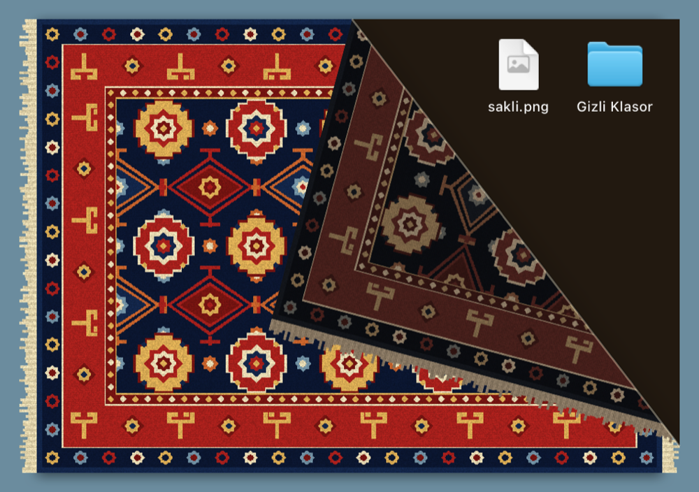
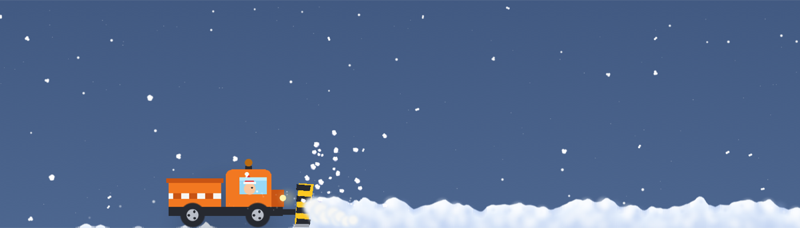
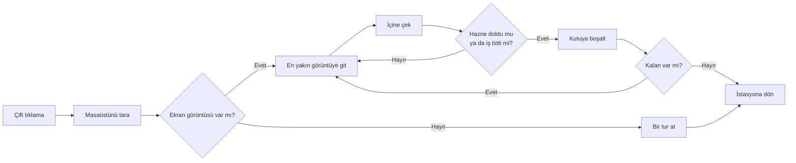

<div align="center">


# Deskling

**Masaüstünde yaşayan küçük yardımcın: ekran görüntülerini toplayan robot süpürge, altına dosya saklayabildiğin Türk motifli halı, fareyle kardan adam yapabildiğin gerçekçi kar, dosyaları sıkıştıran bir kara delik, port ve Docker kontrol merkezi, akıllı pano yöneticisi ve içeceği gerçekten azalan bir Pomodoro sayacı.**

macOS · Swift · AppKit · SwiftUI · Core Animation · Metal

</div>

---

Deskling bir robot süpürge olarak başladı, sonra masaüstünün her köşesine yayıldı. Her şey tek bir menü çubuğu uygulamasında, internet bağlantısı olmadan ve verilerin bu Mac'ten çıkmadan çalışır. Her özellik ayrı ayrı açılıp kapatılabilir.

### Robot süpürge

Masaüstün ekran görüntüleriyle dolduğunda robota çift tıkla. Robot istasyonundan çıkar, her ekran görüntüsüne tek tek gider, onu animasyonla içine çeker ve istasyondaki kutuya boşaltır. **Hiçbir dosya silinmez.** Toplananlar bir klasörde seni bekler, neyi saklayacağına sen karar verirsin.

| Tarıyor | Süpürüyor | Kutuya boşaltıyor |
| :---: | :---: | :---: |
|  |  |  |

## Özellikler

- **Masaüstünde yaşar:** Robot sol alt köşedeki istasyonunda durur. Masaüstü simgelerinin üstünde, açık pencerelerin arkasında kalır.
- **Çift tıkla çalışır:** Robota çift tıklaman yeterli, onay sormaz.
- **1 saat kuralı:** Masaüstünde 1 saati geçen ekran görüntülerini robot kendiliğinden toplar.
- **Mac açılınca başlar:** Uygulamalar klasöründen çalışırken oturum açıldığında kendiliğinden gelir.
- **Yalnızca gerçek ekran görüntülerini alır:** Dosya adına bakmaz, macOS'un ekran görüntüsü işaretini arar.
- **Silmez, toplar:** Görüntüler istasyondaki kutuya, yani bir klasöre taşınır.
- **Kutuya tıkla, klasörü aç:** İstasyondaki kutuya tek tıklayınca topladığı görüntüler Finder'da açılır.
- **Denetim paneli:** Bulunan görüntüleri önizle, seç, kilitle ve geçmişten geri al.
- **Canlı animasyonlar:** Dönen fırçalar, lidar, tarama dalgaları ve kutuya uçan görüntüler.
- **İçine çekerek alır:** Robot dosyanın önünde durur, dosya uzayıp küçülerek ağzından içeri girer.
- **Çarptığını iter:** Yoluna çıkan dosya ve klasörler darbeyle yana kayar. Panelden kapatılabilir.
- **Her gezinti farklı:** Temizlenecek bir şey yoksa zikzak, döngü, sekiz, spiral gibi değişen rotalarda gezer.
- **Türk motifli halı:** Masaüstünde sürükle, köşesinden katla, dosyalarını altına süpür.
- **Gerçekçi kar:** Pencerelerin üstünde ve ekranın altında birikir, pencere sallanınca veya kapanınca dökülür.
- **Kar küreme aracı:** Zemin dolunca küçük bir kamyon gelip karı temizler.
- **Kara delik:** Sol üst köşedeki kara deliğe dosya bırak: görselleri, PDF'leri ve videoları sıkıştırır, PDF birleştirir, ZIP yapar, arşiv açar, JSON ve CSV dönüştürür.
- **Portlar ve servisler:** Dinlenen portları gör, tek tıkla tarayıcıda aç ya da kapat, Docker konteynerlerini başlat ve durdur.
- **Pano yöneticisi:** ⇧⌘V ile kopyalama geçmişine ulaş, klavyeyle seç ve yapıştır.
- **İçecekli Pomodoro:** Masaüstündeki çay, Türk kahvesi, kahve ya da bira odak süresiyle birlikte azalır, molada yeniden dolar.
- **Kar topu ve kardan adam:** Biriken karı fareyle yuvarla, topları üst üste koyup süsle. Yüksekten düşen kardan adam kar yığınına döner.
- **Pil ve şarj:** Pili azalan robot görevine ara verip istasyonda şarj olur, sonra kaldığı yerden devam eder.

## Türk motifli halı

Koçboynuzu bordürü, Selçuklu yıldızları ve basamaklı göbekleriyle tamamen kodla dokunan bir halı. Altına süpürdüğün her şey masaüstünden kaybolur ve robot onlara dokunamaz.

| Örtülü | Köşesinden katlanmış |
| :---: | :---: |
|  |  |

| Yapmak istediğin | Nasıl? |
| --- | --- |
| Halıyı taşı | Ortasından tutup sürükle |
| Köşesini katla | Köşesini içeri doğru çek ya da köşeye tıkla |
| Altına süpür | Dosya, klasör veya ekran görüntüsünü halının üstüne bırak |
| Örtüp kapat | Katlanmış kısma tıkla |
| Geri çıkar | Katlayıp dosyayı dışarı sürükle ya da sağ tıkla → **Masaüstüne Geri Çıkar** |
| Boyutunu değiştir | Sağ tıkla → **Küçük / Orta / Büyük Halı** ya da **Ayarlar** → **Boyut** (%60–%160) |
| Gizle veya göster | Sağ tıkla → **Halıyı Gizle** ya da menü çubuğundaki simge |

Halının altına süpürülen dosyalar şu özel klasöre taşınır, robot bu klasöre hiç bakmaz:

```text
~/Library/Application Support/Deskling/Halı Altı
```

Halıyı bir ekran görüntüsünün üstüne çekmek de onu robottan korur. Bu koruma Finder'ın bildirdiği simge konumuna bağlıdır ve halı gizlenince kalkar. Kesin koruma için dosyayı halının altına süpür.

## Kar

Metal ile çizilen, ekrandaki gerçek pencereleri takip eden bir kar simülasyonu. Kar tıklamaları engellemez, Dock ve menü çubuğunun arkasından geçer.

<div align="center">

</div>

| Olay | Kar ne yapar? |
| --- | --- |
| Yağış | Küçük taneler rüzgârla süzülür, havada değen taneler birleşip büyür |
| Birikme | Pencerelerin üst kenarında ve ekranın altında topaklı bir örtü oluşur |
| Yavaş taşıma | Kar pencerenin üstünde kalır |
| Hızlı taşıma veya sallama | Kar kopar, topak topak dökülür |
| Boyut değiştirme | Kenardan taşan kar düşer, kalanı yeni genişliğe oturur |
| Kapatma veya Dock'a indirme | Pencerenin üstündeki karın tamamı aşağı düşer |
| Sınıra ulaşma | Kar pencerede 16, zeminde 44 noktadan fazla yükselmez |

### Kar küreme aracı

<div align="center">

</div>

Zemin, birikme sınırının yarısına kadar dolunca turuncu bir kamyon ekrana girer. Karı bıçağıyla önüne katar, havaya savurur ve diğer uçtan çıkar. Her geçişten sonra en az bir dakika bekler.

Karı ve küreme aracını menü çubuğundaki simgeden ya da **Ayarlar** sekmesinden açıp kapatabilirsin. Yoğunluk ve birikme sınırı da aynı sekmeden ayarlanır.

### Kar topu ve kardan adam

<div align="center">

</div>

| Yapmak istediğin | Nasıl? |
| --- | --- |
| Kar topu yap | Biriken karın üstüne sol tıkla, bir avuç kar alınır |
| Topu büyüt | Basılı tutup karın üstünde sürükle. Top yuvarlandıkça karı toplar, arkasında iz kalır |
| Kardan adam yap | Bir topu başka bir topun üstüne bırak. İkinci topla yüz ve kollar, üçüncüyle şapka ve atkı gelir |
| Süsle | Topa sağ tıkla: gözler, havuç burun, dal kollar, düğmeler, şapka, atkı |
| Kardan adamı taşı | En alttaki topu tut. Üstündeki toplar onunla birlikte gelir, sertçe sallarsan düşerler |
| Fırlat | Topu hızla savurarak bırak |
| Kar yığınından top yap | Yığına tıkla ya da topu yığının üstünde yuvarla |

### Yer çekimi

<div align="center">

</div>

| Düşme | Ne olur? |
| --- | --- |
| Alçaktan | Top sağlam kalır, bir an ezilip toparlanır |
| Orta yükseklikten | Top kalıcı olarak basıklaşır, üstündeki toplar sarsılıp düşebilir |
| Yüksekten (yaklaşık ekranın yarısı) | Top dağılır. Bir kısmı topak topak sıçrar, kalanı yerde yayılan bir kar yığını olur |
| Kardan adam yüksekten | Bütün toplar tek bir yığına çöker. Şapka, havuç, kollar, atkı ve kömürler yığının üstüne düşer |
| Bir top başka bir topun üstüne hızla | İkisi birbirine gömülür ve alttaki topun yerinde tek bir yığın olur |

Yığınlar zeminin biçimini izler, çukurlara ve topun bıraktığı izlere dökülür. Yağan kar yığınlara da yapışır.

Toplar pencerelerin üstünde de durur. Pencere yavaşça taşınırsa top onunla gider, sertçe çekilir ya da kapanırsa düşer. Küreme aracı yerdeki kar yığınlarını kürer. Küçük topları bıçağının önüne katıp yuvarlar, top yolundaki karı toplayarak büyür. Büyük topları ve kardan adamları ise parçalayıp önündeki kara katar. Pencerelerin üstündeki toplara dokunmaz.

Pencere yalnızca imleç birikmiş karın veya bir topun üstündeyken tıklamayı alır, geri kalan her yerde tıklama alttaki uygulamaya geçer. Bu özelliği **Ayarlar > Fareyle kar topu yapılsın** ile kapatabilirsin.

## Kara delik

<div align="center">

</div>

Masaüstünün sol üst köşesinde, ışığı büken bir birikim diskiyle dönen bir kara delik durur. Üstüne dosya sürükleyince çekim alanı büyür, disk hızlanır ve dosyaya doğru bir akıntı uzanır. Bıraktığın dosya spiral çizip diske yassılarak içeri çekilir. İşlem bitince sonuç parçacıklarla dışarı fırlar, deliğin üstünde birkaç saniye bir etiket görünür.

| Bırakış | Renk | Ne olur? |
| --- | --- | --- |
| Görsel (PNG, JPG, HEIC, TIFF, WebP) | Mor | Sıkışır ya da dönüşür (`_compressed`, HEIC ve WebP için `_converted`) |
| Tek PDF | Mor | İçindeki görseller yeniden sıkıştırılır, yazılar keskin kalır (`_compressed.pdf`) |
| Birden çok PDF | Mor | Bırakıldığı sırayla tek PDF'te birleşir (`_merged.pdf`) |
| Video (MOV, MP4, M4V) | Mor | HEVC ya da H.264 ile hafif bir MP4'e sıkışır (`_compressed.mp4`) |
| Klasör ya da karışık dosyalar | Mor | Tek bir ZIP olur |
| Tek satırlık JSON | Mor | Okunur hale gelir (`_formatted.json`) |
| Girintili JSON | Mor | Tek satıra küçülür (`_minified.json`) |
| CSV | Mor | JSON'a dönüşür (`_converted.json`) |
| ZIP, TAR, TAR.GZ ya da **Shift** basılı | Beyaz | Arşiv yanındaki klasöre açılır |
| **Shift** ile tek PDF | Beyaz | Her sayfa ayrı PDF olarak bir klasöre çıkar |
| **Shift** ile görseller | Beyaz | Görseller tek bir PDF'in sayfaları olur |
| **Shift** ile sesli video | Beyaz | Sesi M4A olarak ayrılır (`_audio.m4a`) |
| **Shift** ile sessiz kısa video | Beyaz | En fazla 30 saniyelik video, saniyede 10 karelik bir GIF olur |
| **Option** basılı | Kırmızı | Dosyalar Çöp Sepeti'ne taşınır |

Kırmızı mod dışında orijinal dosyaya hiç dokunulmaz. Çıktı orijinalin yanına kaydedilir, aynı adda bir dosya varsa üzerine yazılmaz. İşlenemeyen dosyayı kara delik geri tükürür. JSON düzenlenirken anahtar sırası korunur. CSV'de noktalı virgül, tırnaklı alanlar ve Windows Türkçe kodlaması tanınır. ZIP'ler `__MACOSX` artığı içermez, her sistemde temiz açılır.

Kara deliği sürükleyip istediğin yere taşıyabilirsin. Sağ tıklayınca kısa bir kullanım özeti, "İşlemden sonra orijinali Çöp Sepeti'ne taşı" seçeneği, yerine geri koyma ve gizleme seçenekleri açılır. Menü çubuğundaki simgeden ve **Ayarlar** sekmesinden de açılıp kapatılabilir.

Görsellerde çıktı biçimi (JPG, HEIC, WebP) ve kalite (Düşük, Orta, Yüksek) sağ tık menüsünden ya da **Ayarlar** sekmesinden seçilir. Düşük kalitede uzun kenar 2048, ortada 3840 pikselle sınırlanır, yüksekte boyut değişmez. Fotoğraflardaki konum bilgisi varsayılan olarak silinir, diğer fotoğraf bilgileri korunur. Yan çekilmiş fotoğraflar düz kaydedilir, saydam ekran görüntüleri JPG olurken beyaz zemine oturur. Sıkıştırma dosyayı küçültmezse yeni dosya tutulmaz ve kara delik dosyayı geri tükürür. Şifreli PDF'lere dokunulmaz.

WebP yazmak için `cwebp` gerekir, macOS bunu kendisi yazamaz. Kurulu değilse WebP seçeneği kapalı görünür:

```bash
brew install webp
```

Videolar da aynı kalite ayarını kullanır: düşük kalite 720p H.264, orta kalite 1080p HEVC, yüksek kalite çözünürlüğü koruyan HEVC verir. Video gibi uzun süren işlerde kara deliğin üstünde bir ilerleme yüzdesi görünür. MKV ve AVI dosyalarını macOS açamadığı için bunlar yalnızca `ffmpeg` kuruluysa işlenir:

```bash
brew install ffmpeg
```

## Portlar ve servisler

<div align="center">

</div>

Denetim panelindeki **Portlar** sekmesi, terminal açıp `lsof` yazmadan geliştirme ortamını yönetmeni sağlar. Menü çubuğundaki **Portlar ve Servisler** ile doğrudan açılır.

- O an dinlenen bütün TCP portlarını, kullanan uygulamayı, çalıştığı klasörü ve komutunu gösterir. IPv4 ve IPv6 kayıtları tek satırda birleşir.
- Her port **yalnızca bu Mac** ya da **ağa açık** diye işaretlenir.
- 🧭 ile `http://localhost:PORT` tarayıcıda açılır. ✕ ile süreç kibarca kapatılır, kapanmazsa **Zorla kapat** çıkar.
- Başka kullanıcıya ait süreçler kapatılamaz. macOS servisleri için önce onay istenir. 5000 ve 7000 portlarını tutan AirPlay Alıcısı için nasıl kapatılacağı yazılır.
- Docker konteynerleri, Compose proje adı ve yayınladığı portlarla listelenir. Tek tıkla başlatılır ya da durdurulur. Docker Desktop kapalıysa açma düğmesi çıkar.
- Sekme açıkken liste 4 saniyede bir yenilenir, kapalıyken hiç tarama yapılmaz.

## Pano yöneticisi

<div align="center">

</div>

Kopyaladığın metinleri, bağlantıları, kod parçalarını ve renk kodlarını kaynak uygulamasıyla birlikte saklar. **⇧⌘V** ile hangi uygulamadaysan imlecin yanında, odağı çalmadan açılır.

| Tuş | Ne yapar? |
| --- | --- |
| ↑ ↓ | Kayıtlar arasında gezinir |
| ↩ | Seçili kaydı öndeki uygulamaya yapıştırır |
| ⇧↩ ya da ⇧ tık | Biçimi bırakıp düz metin olarak yapıştırır |
| ⌘1 – ⌘9 | İlk dokuz kayıttan birini hemen yapıştırır |
| ⌘P | Sabitler; sabitlenenler en üstte kalır ve silinmez |
| ⌘⌫ | Kaydı siler |
| ⎋ | Pencereyi kapatır |

- Arama Türkçe harflere duyarsızdır. "renk", "link" ya da "kod" yazınca o türdekiler gelir.
- Renk kodlarının yanında rengi görünür. HEX, RGB ve HSL arasında tek tıkla çevrilip kopyalanır.
- Aynı metni yeniden kopyalarsan yeni kayıt açılmaz, var olan en üste çıkar.
- Pano yalnızca değiştiğinde okunur (`changeCount`), boştayken işlemciye yük olmaz.
- Parola yöneticilerinin gizli işaretlediği kopyalar ve Finder'da kopyalanan dosyalar kaydedilmez.
- Geçmiş yalnızca bu Mac'te, yalnızca senin okuyabildiğin bir dosyada (`~/Library/Application Support/Deskling/pano.json`) tutulur.

Otomatik yapıştırma için macOS **Erişilebilirlik** izni ister. İzin yoksa seçtiğin kayıt panoya kopyalanır, ⌘V ile yapıştırırsın. Kısayolu, kayıt sınırını ve izni **Ayarlar > Pano** bölümünden değiştirebilirsin. ⇧⌘V bazı uygulamalarda "Biçimi eşleştirerek yapıştır" kısayoludur; istersen başka bir kısayol seçebilirsin.

## İçecekli Pomodoro

<div align="center">

</div>

Masaüstünde bir içecek durur ve odak süresi boyunca yavaş yavaş azalır. Hepsi kodla çizilir; dışarıdan resim ya da GIF kullanılmaz.

| İçecek | Neler var? |
| --- | --- |
| **İnce belli çay** | Tavşan kanı çay, kalın camlı dip, porselen tabak ve kaşık. Buhar süre ilerledikçe incelir, sona doğru kesilir. Süre bitince bardak titrer, kaşık tabakta şıngırdar. |
| **Türk kahvesi** | Altın yaldızlı, lale motifli fincan. Köpük hafifçe nefes alır; kahve azaldıkça fincanın çeperinde telve izi kalır. |
| **Kahve** | Mat seramik kupa, koyu kahve, yüzeyde dalgalanan pencere yansıması. Molada akan kahveyle yeniden dolar. |
| **Bira** | Kehribar bira, kabarık köpük, dipten yükselen baloncuklar, terleyen cam. Her yudum camda ince bir köpük izi bırakır. |

- **Sürükle:** Bardağı tutup taşıdığında sıvı hareketin tersine yığılır, bırakınca yavaşça durulur.
- **Üzerine gel:** Bardağın altında kalan süre, başlat/duraklat, sıfırla ve atla düğmeleri belirir.
- **Çift tıkla:** Sayacı başlatır ya da duraklatır.
- **Sağ tıkla:** İçeceği, boyutu değiştir ya da gizle.
- **Menü çubuğu:** Sayaç çalışırken içeceğin simgesi ve kalan süre (`24:12`) görünür; simge de süreyle birlikte boşalır.
- **Döngü:** 25 dakika odak, 5 dakika mola, 4 odakta bir 15 dakika uzun mola. Hepsi değiştirilebilir.
- **Uyarılar:** Süre bitince macOS bildirimi ve içeceğe yakışan yumuşak bir ses gelir; ikisi de kapatılabilir.
- **Uyanık tut:** İstersen odak sırasında ekran kararmaz.
- **Robot ve karla birlikte:** İstersen odakta kar yağışı ve robot duraklar. Molada robot, odak sırasında masaüstüne düşen ekran görüntülerini toplar. Kilitli ve halının altındaki dosyalara dokunmaz.

<div align="center">

</div>

Sayaç uygulama kapanıp açılsa da kaldığı yerden sürer. Animasyon yoğunluğu **Düşük** seçilirse kare hızı ve partikül sayısı azalır.

## Denetim paneli

<div align="center">

</div>

Panele menü çubuğundaki yuvarlak simgeden ulaşırsın.

| Sekme | Ne yapar? |
| --- | --- |
| **Bulunanlar** | Masaüstündeki ekran görüntülerini listeler. Seçtiklerini toplatır, kilitlediklerine robot dokunmaz. |
| **Geçmiş** | Toplanan her dosyayı gösterir ve tek tıkla masaüstüne geri koyar. |
| **Portlar** | Dinlenen portlar ve Docker konteynerleri. |
| **Odak** | Pomodoro sayacı, içecek seçimi, süreler, görünüm ve robot/kar senkronu. |
| **Ayarlar** | Otomatik toplama süresi, robot hızı, hazne kapasitesi, kar, küreme aracı, halı boyutu, açılışta başlatma ve sesler. |

## Nasıl çalışır?



### Ekran görüntüsü nasıl anlaşılır?

Robot bir dosyayı almadan önce şu iki işaretten birini arar:

1. Spotlight'taki `kMDItemIsScreenCapture` kaydı
2. Görüntünün EXIF verisindeki `Screenshot` imzası

Adı "Ekran Resmi" olan sıradan bir görsel bu yüzden alınmaz.

### Dosyaların güvenliği

- Dosyalar yalnızca taşınır, uygulama hiçbir dosyayı silmez.
- Taşımadan hemen önce dosya yeniden doğrulanır. Tarandıktan sonra değişen dosyaya dokunulmaz.
- Kutuda aynı adlı dosya varsa üzerine yazılmaz, yeni dosya numaralandırılır.
- Alt klasörlere ve sembolik bağlantılara girilmez.
- Kilitlenen dosyalar hiçbir modda alınmaz.

Toplanan görüntüler şu klasörde durur:

```text
~/Library/Application Support/Deskling/Toz Haznesi
```

## Robo Süpürge'den geçiş

Uygulamanın eski adı Robo Süpürge'ydi. Deskling ilk açıldığında eski ayarları, toz haznesini, halının altındaki dosyaları, geçmişi ve pano kayıtlarını kendiliğinden yeni yerine taşır. Hiçbir şey silinmez. Uygulama kimliği değiştiği için macOS Masaüstü, Finder ve Erişilebilirlik izinlerini bir kez yeniden sorar.

## Kurulum

**Gereksinimler:** Apple Silicon işlemcili bir Mac, macOS 13 veya üzeri, Xcode Command Line Tools.

```bash
git clone https://github.com/furkandemirbozan/deskling.git
```

```bash
cd deskling
```

```bash
./build.sh
```

```bash
cp -R "Deskling.app" /Applications/
```

```bash
open /Applications/Deskling.app
```

### İzinler

İlk kullanımda macOS iki izin sorar. Üçüncüsü isteğe bağlıdır:

| İzin | Neden gerekli? |
| --- | --- |
| **Masaüstü klasörü** | Ekran görüntülerini bulmak için |
| **Finder otomasyonu** | Simgelerin yerini öğrenmek ve çarpılan simgeleri kaydırmak için |
| **Bildirimler** (isteğe bağlı) | Pomodoro süresi bitince haber vermek için |
| **Erişilebilirlik** (isteğe bağlı) | Pano geçmişinden seçilen kaydı öndeki uygulamaya kendiliğinden yapıştırmak için |

Uygulama yerel olarak imzalandığı için her yeniden derlemeden sonra macOS izinleri yeniden sorabilir.

Finder izni verilmezse robot simgelerin yerini macOS'un varsayılan yerleşimine göre tahmin eder ve simgeleri itmez.

## Kullanım

| Yapmak istediğin | Nasıl? |
| --- | --- |
| Temizliği başlat | Robota **çift tıkla** |
| Toplananları gör | İstasyondaki kutuya **tek tıkla** |
| Paneli aç | Menü çubuğundaki simge → **Denetim Panelini Aç** |
| Dosyalara dokunmadan dene | Panel → **Demoyu izle** |
| Uygulamayı kapat | Menü çubuğundaki simge → **Çıkış** |

## Proje yapısı

```text
Sources/
├── Migration.swift  Robo Süpürge'den Deskling'e ayar ve veri geçişi
├── main.swift       Uygulama girişi ve menü çubuğu
├── AppModel.swift   Uygulama durumu, tarama ve görev yönetimi
├── Core.swift       Algılama, dosya taşıma ve masaüstü geometrisi
├── Engine.swift     Robotun hareket motoru
├── Motion.swift     Gezinti rotaları, simgelere çarpma ve içine çekme hareketi
├── MotionCheck.swift Hareket testleri
├── Overlay.swift    Masaüstü sahnesi, tıklama alanları ve animasyonlar
├── RobotArt.swift   Kodla çizilen robot, istasyon ve uygulama simgesi
├── PanelView.swift  SwiftUI denetim paneli
├── Rug.swift        Halı penceresi, katlama ve halı altı klasörü
├── RugArt.swift     Kodla dokunan Türk motifli halı
├── RugCheck.swift   Halının uçtan uca testi
├── Snow.swift       Kar penceresi, pencere takibi ve Metal çizimi
├── SnowEngine.swift Kar fiziği ve kar küreme aracı
├── SnowCheck.swift  Kar fiziği testleri
├── SnowSculpt.swift Kar topu, kardan adam, kar yığını ve yer çekimi
├── SculptCheck.swift Kar topu testleri
├── DevCenter/
│   ├── PortScanner.swift  Dinlenen portlar ve Docker
│   ├── DevCenter.swift    Portlar sekmesinin durumu ve işlemleri
│   ├── PortsView.swift    Portlar sekmesi
│   └── DevCheck.swift     Port ve Docker testleri
├── Clipboard/
│   ├── ClipItem.swift          Kayıt, tür algılama ve renk dönüşümleri
│   ├── ClipboardStore.swift    Pano takibi ve geçmiş
│   ├── HotKey.swift            Genel kısayol ve yapıştırma
│   ├── ClipboardPanel.swift    Yüzer pano penceresi
│   └── ClipboardCheck.swift    Pano testleri
├── Pomodoro/
│   ├── PomodoroManager.swift  Odak, kısa ve uzun mola durum makinesi
│   ├── PomodoroSettings.swift İçecek temaları, boyutlar ve ayar sınırları
│   ├── PomodoroModel.swift    Ayarlar, bildirim, ses ve uyanık tutma bağlantısı
│   ├── PomodoroAlerts.swift   Bildirim, ses ve ekranı uyanık tutma
│   ├── PomodoroTab.swift      Odak sekmesi
│   ├── DrinkController.swift  İçecek penceresi, sürükleme, sağ tık menüsü
│   ├── DrinkView.swift        Katmanlı, düşük yüklü çizim
│   ├── DrinkControlBar.swift  Üzerine gelince beliren kontrol çubuğu
│   ├── SloshPhysics.swift     Sıvının çalkalanması
│   ├── DrinkParticles.swift   Buhar, baloncuk, damla ve köpük izi
│   ├── DrinkArt.swift         Ortak çizim, önbellek ve dolum akışı
│   ├── TeaGlass.swift, TurkishCoffee.swift, CoffeeMug.swift, BeerPint.swift  İçecekler
│   ├── DrinkIcons.swift       Menü çubuğu simgeleri
│   └── PomodoroCheck.swift, PomodoroSyncCheck.swift, DrinkUICheck.swift  Testler
├── BlackHole/
│   ├── BlackHoleController.swift Kara delik penceresi, sürükle bırak ve animasyonlar
│   ├── HoleRenderer.swift        Işığı büken diskin Metal çizimi
│   ├── HoleProcessor.swift       ZIP, arşiv açma, JSON ve CSV işlemleri
│   ├── HoleMedia.swift           Görsel ve PDF işlemleri
│   ├── HoleVideo.swift           Video sıkıştırma, ses ayırma ve GIF
│   ├── HoleVideoCheck.swift      Video testleri
│   ├── HoleMediaCheck.swift      Görsel ve PDF testleri
│   ├── HoleCheck.swift           İşlem ve görünüm testleri
│   └── HoleUICheck.swift         Kara delik penceresinin uçtan uca testi
└── SelfTest.swift   Otomatik testler
build.sh             .app paketini derler ve imzalar
```

## Testler

Testler geçici klasörlerde çalışır, gerçek masaüstüne dokunmaz.

```bash
Deskling.app/Contents/MacOS/Deskling --self-test
```

```bash
Deskling.app/Contents/MacOS/Deskling --double-click-check
```

```bash
Deskling.app/Contents/MacOS/Deskling --patrol-check
```

```bash
Deskling.app/Contents/MacOS/Deskling --auto-check
```

```bash
Deskling.app/Contents/MacOS/Deskling --rug-check
```

```bash
Deskling.app/Contents/MacOS/Deskling --snow-check
```

```bash
Deskling.app/Contents/MacOS/Deskling --motion-check
```

```bash
Deskling.app/Contents/MacOS/Deskling --sculpt-check
```

```bash
Deskling.app/Contents/MacOS/Deskling --hole-check
```

```bash
Deskling.app/Contents/MacOS/Deskling --hole-ui-check
```

```bash
Deskling.app/Contents/MacOS/Deskling --dev-check
```

```bash
Deskling.app/Contents/MacOS/Deskling --clip-check
```

```bash
Deskling.app/Contents/MacOS/Deskling --migration-check
```

```bash
Deskling.app/Contents/MacOS/Deskling --pomo-check
```

```bash
Deskling.app/Contents/MacOS/Deskling --pomo-sync-check
```

```bash
Deskling.app/Contents/MacOS/Deskling --drink-ui-check
```

## Bilinen sınırlar

- Robot, halı ve kar yalnızca ana ekranda çalışır.
- Masaüstünde "Izgaraya hizala" veya otomatik sıralama açıksa Finder itilen simgeleri kendi düzenine geri çekebilir.
- Kar açıkken uygulama işlemcinin yaklaşık %8-10'unu kullanır. Masaüstündeki içecek yüksek animasyonda yaklaşık %5, düşükte %2-3 ekler.
- Derleme betiği yalnızca Apple Silicon (arm64) için paket üretir.
- Mac açılışında başlatma yalnızca `/Applications` klasöründeki kopyada çalışır.
