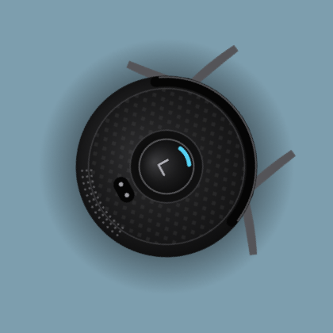
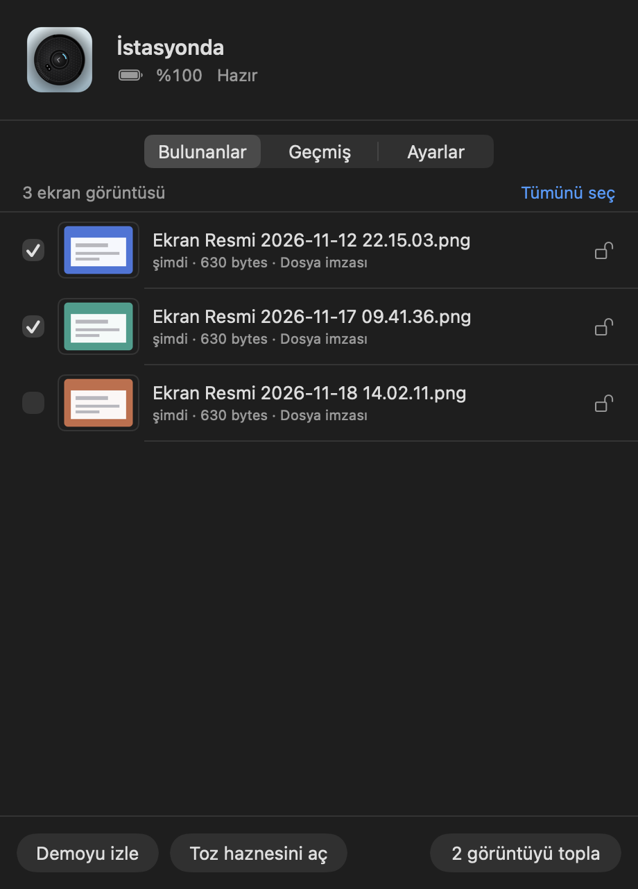
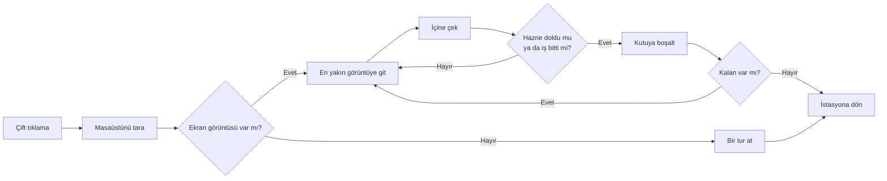

<div align="center">



# Robo Süpürge

**Masaüstünde yaşayan, ekran görüntülerini toplayıp kutusuna taşıyan minik robot süpürge.**

macOS · Swift · AppKit · SwiftUI · Core Animation

</div>

---

Masaüstün ekran görüntüleriyle dolduğunda robota çift tıkla. Robot istasyonundan çıkar, her ekran görüntüsüne tek tek gider, onu animasyonla içine çeker ve istasyondaki kutuya boşaltır. **Hiçbir dosya silinmez.** Toplananlar bir klasörde seni bekler, neyi saklayacağına sen karar verirsin.

| Tarıyor | Süpürüyor | Kutuya boşaltıyor |
| :---: | :---: | :---: |
|  |  |  |

## Özellikler

- **Masaüstünde yaşar:** Robot sol alt köşedeki istasyonunda durur. Masaüstü simgelerinin üstünde, açık pencerelerin arkasında kalır.
- **Çift tıkla çalışır:** Robota çift tıklaman yeterli, onay sormaz.
- **Yalnızca gerçek ekran görüntülerini alır:** Dosya adına bakmaz, macOS'un ekran görüntüsü işaretini arar.
- **Silmez, toplar:** Görüntüler istasyondaki kutuya, yani bir klasöre taşınır.
- **Kutuya tıkla, klasörü aç:** İstasyondaki kutuya tek tıklayınca topladığı görüntüler Finder'da açılır.
- **Denetim paneli:** Bulunan görüntüleri önizle, seç, kilitle ve geçmişten geri al.
- **Canlı animasyonlar:** Dönen fırçalar, lidar, tarama dalgaları, spiral emiş ve kutuya uçan görüntüler.
- **Pil ve şarj:** Pili azalan robot görevine ara verip istasyonda şarj olur, sonra kaldığı yerden devam eder.

## Denetim paneli

<div align="center">

</div>

Panele menü çubuğundaki yuvarlak simgeden ulaşırsın.

| Sekme | Ne yapar? |
| --- | --- |
| **Bulunanlar** | Masaüstündeki ekran görüntülerini listeler. Seçtiklerini toplatır, kilitlediklerine robot dokunmaz. |
| **Geçmiş** | Toplanan her dosyayı gösterir ve tek tıkla masaüstüne geri koyar. |
| **Ayarlar** | Temizleme modu, robot hızı, hazne kapasitesi ve sesler. |

## Nasıl çalışır?



### Ekran görüntüsü nasıl anlaşılır?

Robot bir dosyayı almadan önce şu iki işaretten birini arar:

1. Spotlight'taki `kMDItemIsScreenCapture` kaydı
2. Görüntünün EXIF verisindeki `Screenshot` imzası

Adı "Ekran Resmi" olan sıradan bir görsel bu yüzden alınmaz.

### Dosyaların güvenliği

- Dosyalar yalnızca taşınır, uygulama hiçbir dosyayı silmez.
- Taşımadan hemen önce dosya yeniden doğrulanır. Tarandıktan sonra değişen dosyaya dokunulmaz.
- Kutuda aynı adlı dosya varsa üzerine yazılmaz, yeni dosya numaralandırılır.
- Alt klasörlere ve sembolik bağlantılara girilmez.
- Kilitlenen dosyalar hiçbir modda alınmaz.

Toplanan görüntüler şu klasörde durur:

```text
~/Library/Application Support/RoboSupurge/Toz Haznesi
```

## Kurulum

**Gereksinimler:** Apple Silicon işlemcili bir Mac, macOS 13 veya üzeri, Xcode Command Line Tools.

```bash
git clone https://github.com/furkandemirbozan/robo-supurge.git
```

```bash
cd robo-supurge
```

```bash
./build.sh
```

```bash
cp -R "Robo Süpürge.app" /Applications/
```

```bash
open "/Applications/Robo Süpürge.app"
```

### İzinler

İlk kullanımda macOS iki izin sorar:

| İzin | Neden gerekli? |
| --- | --- |
| **Masaüstü klasörü** | Ekran görüntülerini bulmak için |
| **Finder otomasyonu** | Simgelerin masaüstündeki yerini öğrenmek için |

Finder izni verilmezse robot simgelerin yerini macOS'un varsayılan yerleşimine göre tahmin eder.

## Kullanım

| Yapmak istediğin | Nasıl? |
| --- | --- |
| Temizliği başlat | Robota **çift tıkla** |
| Toplananları gör | İstasyondaki kutuya **tek tıkla** |
| Paneli aç | Menü çubuğundaki simge → **Denetim Panelini Aç** |
| Dosyalara dokunmadan dene | Panel → **Demoyu izle** |
| Uygulamayı kapat | Menü çubuğundaki simge → **Çıkış** |

## Proje yapısı

```text
Sources/
├── main.swift       Uygulama girişi ve menü çubuğu
├── AppModel.swift   Uygulama durumu, tarama ve görev yönetimi
├── Core.swift       Algılama, dosya taşıma ve masaüstü geometrisi
├── Engine.swift     Robotun hareket motoru
├── Overlay.swift    Masaüstü sahnesi, tıklama alanları ve animasyonlar
├── RobotArt.swift   Kodla çizilen robot, istasyon ve uygulama simgesi
├── PanelView.swift  SwiftUI denetim paneli
└── SelfTest.swift   Otomatik testler
build.sh             .app paketini derler ve imzalar
```

## Testler

Testler geçici klasörlerde çalışır, gerçek masaüstüne dokunmaz.

```bash
"Robo Süpürge.app/Contents/MacOS/RoboSupurge" --self-test
```

```bash
"Robo Süpürge.app/Contents/MacOS/RoboSupurge" --double-click-check
```

```bash
"Robo Süpürge.app/Contents/MacOS/RoboSupurge" --patrol-check
```

## Bilinen sınırlar

- Robot yalnızca ana ekranda çalışır.
- Derleme betiği yalnızca Apple Silicon (arm64) için paket üretir.
- Uygulama Mac açılışında kendiliğinden başlamaz.
