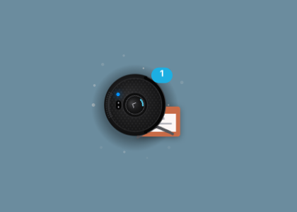
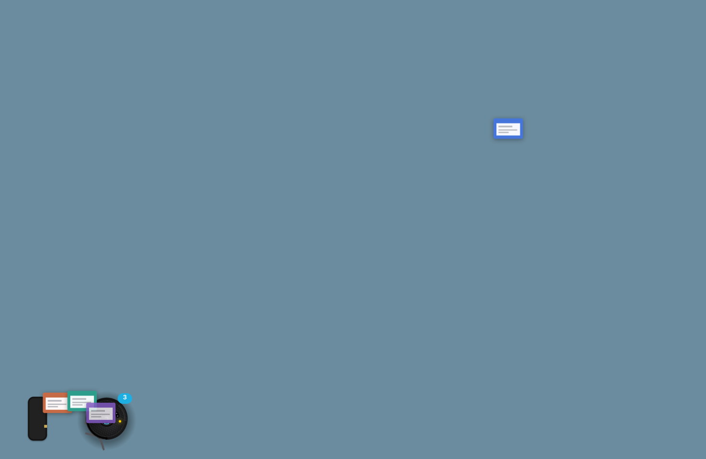
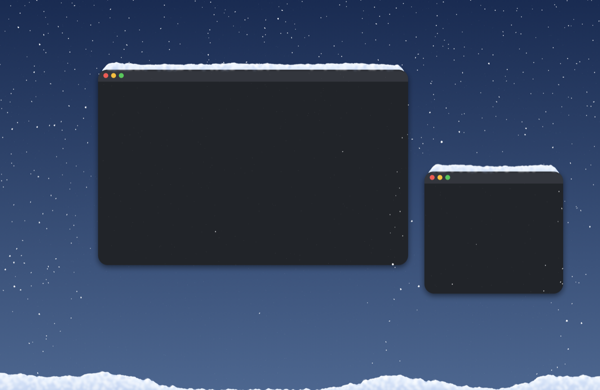
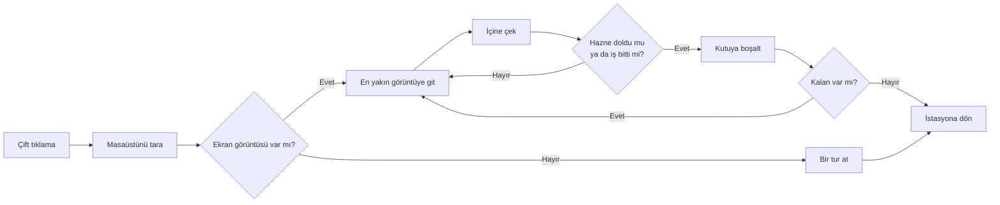

<div align="center">


# Robo Süpürge

**Masaüstünde yaşayan, ekran görüntülerini toplayıp kutusuna taşıyan minik robot süpürge altına dosya saklayabildiğin Türk motifli halı ve pencerelerinde biriken gerçekçi kar.**

macOS · Swift · AppKit · SwiftUI · Core Animation · Metal

</div>

---

Masaüstün ekran görüntüleriyle dolduğunda robota çift tıkla. Robot istasyonundan çıkar, her ekran görüntüsüne tek tek gider, onu animasyonla içine çeker ve istasyondaki kutuya boşaltır. **Hiçbir dosya silinmez.** Toplananlar bir klasörde seni bekler, neyi saklayacağına sen karar verirsin.

| Tarıyor | Süpürüyor | Kutuya boşaltıyor |
| :---: | :---: | :---: |
|  |  |  |

## Özellikler

- **Masaüstünde yaşar:** Robot sol alt köşedeki istasyonunda durur. Masaüstü simgelerinin üstünde, açık pencerelerin arkasında kalır.
- **Çift tıkla çalışır:** Robota çift tıklaman yeterli, onay sormaz.
- **1 saat kuralı:** Masaüstünde 1 saati geçen ekran görüntülerini robot kendiliğinden toplar.
- **Mac açılınca başlar:** Uygulamalar klasöründen çalışırken oturum açıldığında kendiliğinden gelir.
- **Yalnızca gerçek ekran görüntülerini alır:** Dosya adına bakmaz, macOS'un ekran görüntüsü işaretini arar.
- **Silmez, toplar:** Görüntüler istasyondaki kutuya, yani bir klasöre taşınır.
- **Kutuya tıkla, klasörü aç:** İstasyondaki kutuya tek tıklayınca topladığı görüntüler Finder'da açılır.
- **Denetim paneli:** Bulunan görüntüleri önizle, seç, kilitle ve geçmişten geri al.
- **Canlı animasyonlar:** Dönen fırçalar, lidar, tarama dalgaları, spiral emiş ve kutuya uçan görüntüler.
- **Türk motifli halı:** Masaüstünde sürükle, köşesinden katla, dosyalarını altına süpür.
- **Gerçekçi kar:** Pencerelerin üstünde ve ekranın altında birikir, pencere sallanınca veya kapanınca dökülür.
- **Kar küreme aracı:** Zemin dolunca küçük bir kamyon gelip karı temizler.
- **Pil ve şarj:** Pili azalan robot görevine ara verip istasyonda şarj olur, sonra kaldığı yerden devam eder.

## Türk motifli halı

Koçboynuzu bordürü, Selçuklu yıldızları ve basamaklı göbekleriyle tamamen kodla dokunan bir halı. Altına süpürdüğün her şey masaüstünden kaybolur ve robot onlara dokunamaz.

| Örtülü | Köşesinden katlanmış |
| :---: | :---: |
|  |  |

| Yapmak istediğin | Nasıl? |
| --- | --- |
| Halıyı taşı | Ortasından tutup sürükle |
| Köşesini katla | Köşesini içeri doğru çek ya da köşeye tıkla |
| Altına süpür | Dosya, klasör veya ekran görüntüsünü halının üstüne bırak |
| Örtüp kapat | Katlanmış kısma tıkla |
| Geri çıkar | Katlayıp dosyayı dışarı sürükle ya da sağ tıkla → **Masaüstüne Geri Çıkar** |
| Boyutunu değiştir | Sağ tıkla → **Küçük / Orta / Büyük Halı** ya da **Ayarlar** → **Boyut** (%60–%160) |
| Gizle veya göster | Sağ tıkla → **Halıyı Gizle** ya da menü çubuğundaki simge |

Halının altına süpürülen dosyalar şu özel klasöre taşınır, robot bu klasöre hiç bakmaz:

```text
~/Library/Application Support/RoboSupurge/Halı Altı
```

Halıyı bir ekran görüntüsünün üstüne çekmek de onu robottan korur. Bu koruma Finder'ın bildirdiği simge konumuna bağlıdır ve halı gizlenince kalkar. Kesin koruma için dosyayı halının altına süpür.

## Kar

Metal ile çizilen, ekrandaki gerçek pencereleri takip eden bir kar simülasyonu. Kar tıklamaları engellemez, Dock ve menü çubuğunun arkasından geçer.

<div align="center">

</div>

| Olay | Kar ne yapar? |
| --- | --- |
| Yağış | Küçük taneler rüzgârla süzülür, havada değen taneler birleşip büyür |
| Birikme | Pencerelerin üst kenarında ve ekranın altında topaklı bir örtü oluşur |
| Yavaş taşıma | Kar pencerenin üstünde kalır |
| Hızlı taşıma veya sallama | Kar kopar, topak topak dökülür |
| Boyut değiştirme | Kenardan taşan kar düşer, kalanı yeni genişliğe oturur |
| Kapatma veya Dock'a indirme | Pencerenin üstündeki karın tamamı aşağı düşer |
| Sınıra ulaşma | Kar pencerede 16, zeminde 44 noktadan fazla yükselmez |

### Kar küreme aracı

<div align="center">

</div>

Zemin, birikme sınırının yarısına kadar dolunca turuncu bir kamyon ekrana girer. Karı bıçağıyla önüne katar, havaya savurur ve diğer uçtan çıkar. Her geçişten sonra en az bir dakika bekler.

Karı ve küreme aracını menü çubuğundaki simgeden ya da **Ayarlar** sekmesinden açıp kapatabilirsin. Yoğunluk ve birikme sınırı da aynı sekmeden ayarlanır.

## Denetim paneli

<div align="center">

</div>

Panele menü çubuğundaki yuvarlak simgeden ulaşırsın.

| Sekme | Ne yapar? |
| --- | --- |
| **Bulunanlar** | Masaüstündeki ekran görüntülerini listeler. Seçtiklerini toplatır, kilitlediklerine robot dokunmaz. |
| **Geçmiş** | Toplanan her dosyayı gösterir ve tek tıkla masaüstüne geri koyar. |
| **Ayarlar** | Otomatik toplama süresi, robot hızı, hazne kapasitesi, kar, küreme aracı, halı boyutu, açılışta başlatma ve sesler. |

## Nasıl çalışır?



### Ekran görüntüsü nasıl anlaşılır?

Robot bir dosyayı almadan önce şu iki işaretten birini arar:

1. Spotlight'taki `kMDItemIsScreenCapture` kaydı
2. Görüntünün EXIF verisindeki `Screenshot` imzası

Adı "Ekran Resmi" olan sıradan bir görsel bu yüzden alınmaz.

### Dosyaların güvenliği

- Dosyalar yalnızca taşınır, uygulama hiçbir dosyayı silmez.
- Taşımadan hemen önce dosya yeniden doğrulanır. Tarandıktan sonra değişen dosyaya dokunulmaz.
- Kutuda aynı adlı dosya varsa üzerine yazılmaz, yeni dosya numaralandırılır.
- Alt klasörlere ve sembolik bağlantılara girilmez.
- Kilitlenen dosyalar hiçbir modda alınmaz.

Toplanan görüntüler şu klasörde durur:

```text
~/Library/Application Support/RoboSupurge/Toz Haznesi
```

## Kurulum

**Gereksinimler:** Apple Silicon işlemcili bir Mac, macOS 13 veya üzeri, Xcode Command Line Tools.

```bash
git clone https://github.com/furkandemirbozan/robo-supurge.git
```

```bash
cd robo-supurge
```

```bash
./build.sh
```

```bash
cp -R "Robo Süpürge.app" /Applications/
```

```bash
open "/Applications/Robo Süpürge.app"
```

### İzinler

İlk kullanımda macOS iki izin sorar:

| İzin | Neden gerekli? |
| --- | --- |
| **Masaüstü klasörü** | Ekran görüntülerini bulmak için |
| **Finder otomasyonu** | Simgelerin masaüstündeki yerini öğrenmek için |

Finder izni verilmezse robot simgelerin yerini macOS'un varsayılan yerleşimine göre tahmin eder.

## Kullanım

| Yapmak istediğin | Nasıl? |
| --- | --- |
| Temizliği başlat | Robota **çift tıkla** |
| Toplananları gör | İstasyondaki kutuya **tek tıkla** |
| Paneli aç | Menü çubuğundaki simge → **Denetim Panelini Aç** |
| Dosyalara dokunmadan dene | Panel → **Demoyu izle** |
| Uygulamayı kapat | Menü çubuğundaki simge → **Çıkış** |

## Proje yapısı

```text
Sources/
├── main.swift       Uygulama girişi ve menü çubuğu
├── AppModel.swift   Uygulama durumu, tarama ve görev yönetimi
├── Core.swift       Algılama, dosya taşıma ve masaüstü geometrisi
├── Engine.swift     Robotun hareket motoru
├── Overlay.swift    Masaüstü sahnesi, tıklama alanları ve animasyonlar
├── RobotArt.swift   Kodla çizilen robot, istasyon ve uygulama simgesi
├── PanelView.swift  SwiftUI denetim paneli
├── Rug.swift        Halı penceresi, katlama ve halı altı klasörü
├── RugArt.swift     Kodla dokunan Türk motifli halı
├── RugCheck.swift   Halının uçtan uca testi
├── Snow.swift       Kar penceresi, pencere takibi ve Metal çizimi
├── SnowEngine.swift Kar fiziği ve kar küreme aracı
├── SnowCheck.swift  Kar fiziği testleri
└── SelfTest.swift   Otomatik testler
build.sh             .app paketini derler ve imzalar
```

## Testler

Testler geçici klasörlerde çalışır, gerçek masaüstüne dokunmaz.

```bash
"Robo Süpürge.app/Contents/MacOS/RoboSupurge" --self-test
```

```bash
"Robo Süpürge.app/Contents/MacOS/RoboSupurge" --double-click-check
```

```bash
"Robo Süpürge.app/Contents/MacOS/RoboSupurge" --patrol-check
```

```bash
"Robo Süpürge.app/Contents/MacOS/RoboSupurge" --auto-check
```

```bash
"Robo Süpürge.app/Contents/MacOS/RoboSupurge" --rug-check
```

```bash
"Robo Süpürge.app/Contents/MacOS/RoboSupurge" --snow-check
```

## Bilinen sınırlar

- Robot, halı ve kar yalnızca ana ekranda çalışır.
- Kar açıkken uygulama işlemcinin yaklaşık %8-10'unu kullanır.
- Derleme betiği yalnızca Apple Silicon (arm64) için paket üretir.
- Mac açılışında başlatma yalnızca `/Applications` klasöründeki kopyada çalışır.
